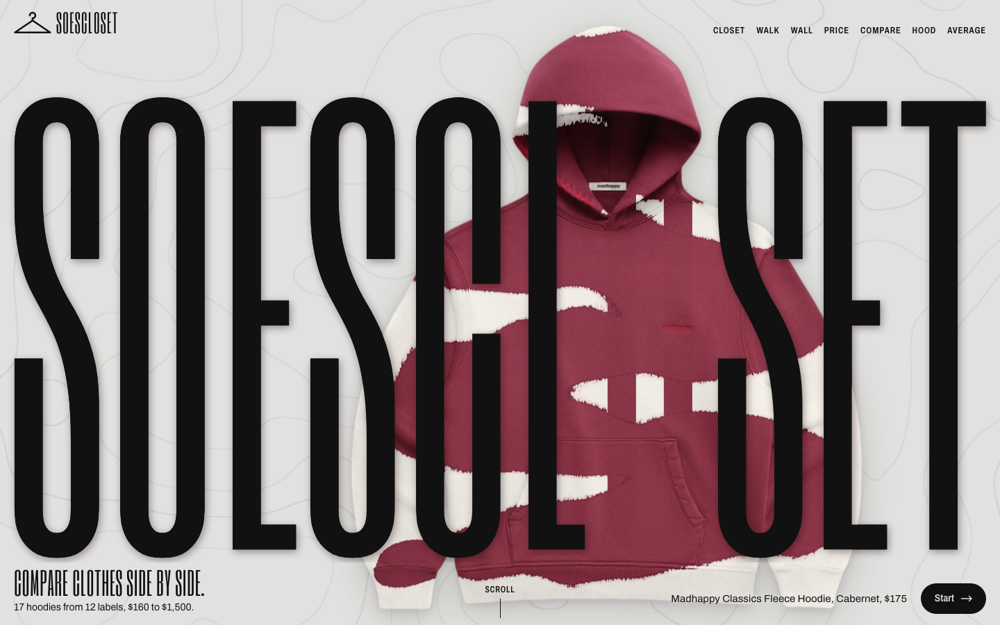
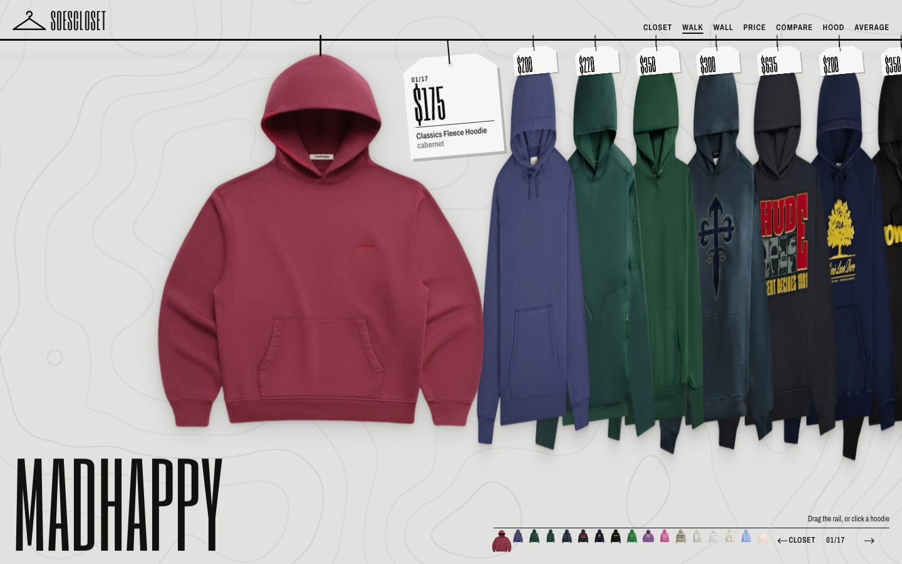
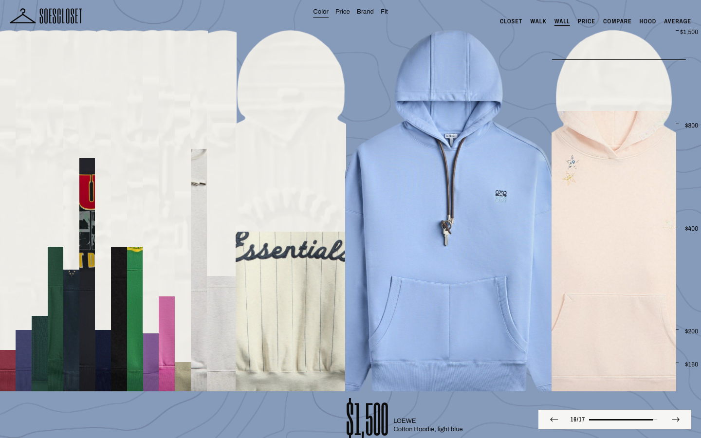
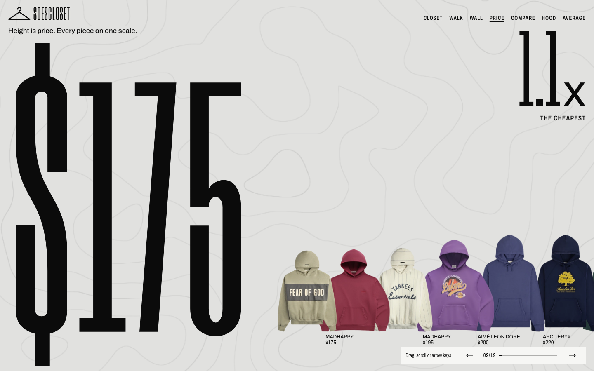

<div align="center">

# SOESCLOSET

**17 pullover hoodies from 12 labels, $160 to $1,500, compared side by side.**

[**Visit the site →**](https://soescloset.vercel.app)



</div>

Most fashion sites let you browse. soescloset lets you compare. Every hoodie is cut out the same way, so pieces from different labels read as one collection, and each room compares them differently.

## Rooms

| Room | What you do there |
|---|---|
| Home | Drag across a plaster hoodie to paint its color back in |
| Closet | See all 17 at once, sort them, find one, or pick two to compare |
| Walk | Slide a rail of hanging hoodies and read their tags |
| Wall | Read price from how high each slit is dyed, then sort by color, price, brand or fit |
| Price | Line every piece up at one scale, height set by price |
| Compare | Split two hoodies down the middle and drag the seam |
| Hood | Compare the hoods: domed or peaked, open or closed |
| Average | All 17 traced on top of each other, plus what the numbers say |

Click any hoodie in any room to open its page: price, fabric, fit, the store's notes and a link to buy.

<table>
<tr>
<td width="50%"></td>
<td width="50%"></td>
</tr>
<tr>
<td></td>
<td></td>
</tr>
<tr>
<td></td>
<td></td>
</tr>
<tr>
<td></td>
<td></td>
</tr>
</table>

<p align="center"></p>

## Labels

Aimé Leon Dore · Arc'teryx · ATON · by Parra · Casablanca · Essentials · Ksubi · Loewe · Madhappy · NAHMIAS · Rhude · vowels

## How it's built

- Plain HTML, CSS and JavaScript. No framework, no build step.
- Every room has its own URL, so links can be shared and Back works.
- Drag, scroll, swipe and arrow keys all move the same way. Changing rooms takes a second push at the end, so you never leave a room by accident.
- `pipeline/` turns product photos into matching cutouts and measures each garment from the image.
- Prices and notes come from the brand and store sites. Shape numbers are measured from the photos.
- Works on phones and with a keyboard. Motion is the same for everyone and stays light.
- The "Suggest a hoodie" box sends links to a Google Sheet through a small Apps Script (`tools/suggest-apps-script.js`).

## Run it locally

```sh
python3 -m http.server 8790 --directory site
```

Then open http://localhost:8790.

## What's next

- Link brand names to their pieces and sites
- Say clearly when a link goes to a retailer and not the brand
- Add more garments beyond pullover hoodies

## Credits

soescloset is an independent comparison and is not affiliated with any brand or store. Product images and names belong to their owners. Prices were read from each brand or store site and may have changed.

Type: Six Caps and Archivo. The product demo in `demo/` uses [Stageshow](https://github.com/benjitaylor/skills/tree/main/stageshow) by Benji Taylor, under the MIT license.
