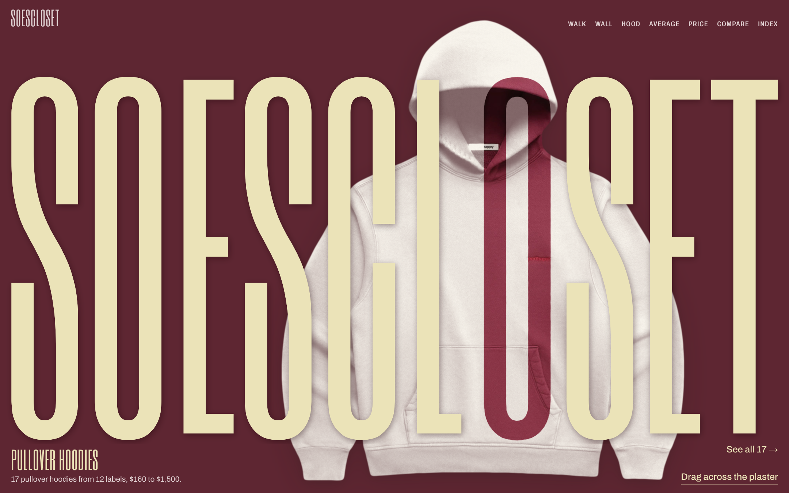
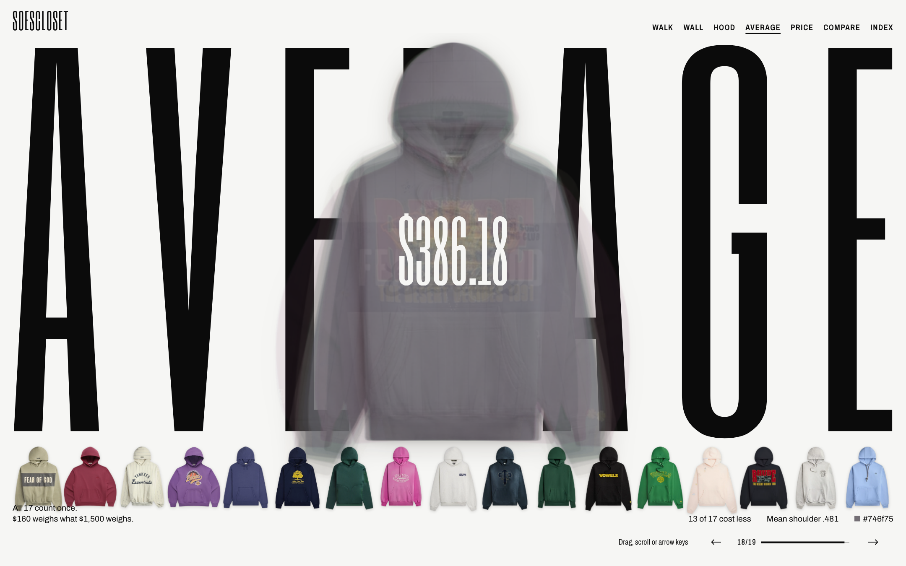
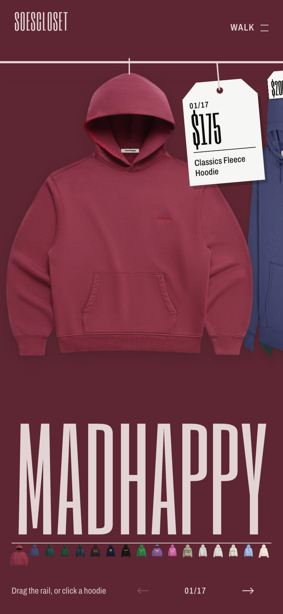

<div align="center">

# SOESCLOSET

**Pullover Hoodies: 17 hoodies from 12 labels, $160 to $1,500, compared by hand, eye and price.**

[**Visit the site →**](https://soescloset.vercel.app)



</div>

Most fashion sites let you browse. soescloset lets you handle things. Every hoodie is cut out in one consistent style, so pieces from different labels read as one collection, and each room compares them in a different way.

## The rooms

| Room | What you do there |
|---|---|
| **Cover** | Drag across a plaster hoodie to paint its true colour back in |
| **Walk** | Pull a rail of hanging hoodies sideways and read their swing tags |
| **Wall** | Read price at a glance from how far each slit is dyed, then sort the set |
| **Hood** | Pan one matching hood crop per piece, and zoom into the cloth |
| **Average** | Meet the blended ghost of all 17 at their true average price |
| **Price** | Line every piece up at one scale, with height set by price |
| **Compare** | Split any two hoodies down the middle and drag the seam |
| **Index** | Go straight to any piece, A to Z |

Click any hoodie, in any room, to expand it. You get its price, the store's notes, its measurements against the other 16, a comparison, and a link to the store.

<table>
<tr>
<td width="50%"></td>
<td width="50%"></td>
</tr>
<tr>
<td></td>
<td></td>
</tr>
<tr>
<td></td>
<td></td>
</tr>
</table>

<p align="center"></p>

## Labels

Aimé Leon Dore · Arc'teryx · ATON · by Parra · Casablanca · Essentials · Ksubi · Loewe · Madhappy · NAHMIAS · Rhude · vowels

## How it's built

- **Plain HTML, CSS and JavaScript.** No framework and no build step.
- **Rooms with real addresses.** Links can be shared, and back and reload land where you expect.
- **One way to move.** Drag, wheel, swipe and arrow keys all drive the same sideways motion.
- **One cutout pipeline.** `pipeline/` turns source photos into matched cutouts and measures each garment from the image.
- **Real data only.** Prices and notes come from the brand and store sites. Shape figures are measured from the photos.
- **Built for everyone.** Keyboard support, reduced motion and phone layouts are included.

## Run it locally

```sh
python3 -m http.server 8741 --directory site
```

Then open http://localhost:8741. To run the checks, with that server still running:

```sh
node tools/check-site.mjs
node tools/use-site.mjs
```

## What's next

- Link brand names to their pieces and sites
- Say clearly when a link goes to a retailer rather than the brand
- Rebuild Wall, Compare, Average and Index with more hands-on controls
- Add more garment sections beyond pullover hoodies

## Credits

soescloset is an independent comparison and is not affiliated with any brand or store. Product images and names belong to their owners. Prices were read from each brand or store site and may have changed.

Type: Six Caps and Archivo. The product demo in `demo/` uses [Stageshow](https://github.com/benjitaylor/skills/tree/main/stageshow) by Benji Taylor, under the MIT license.
