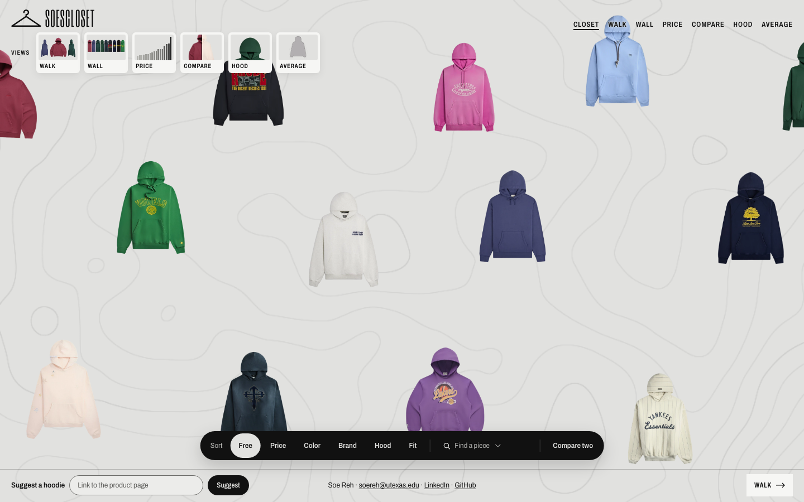
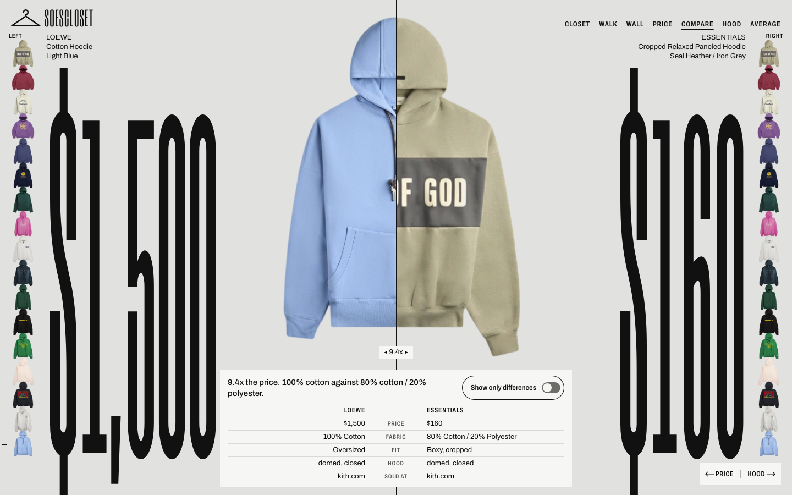
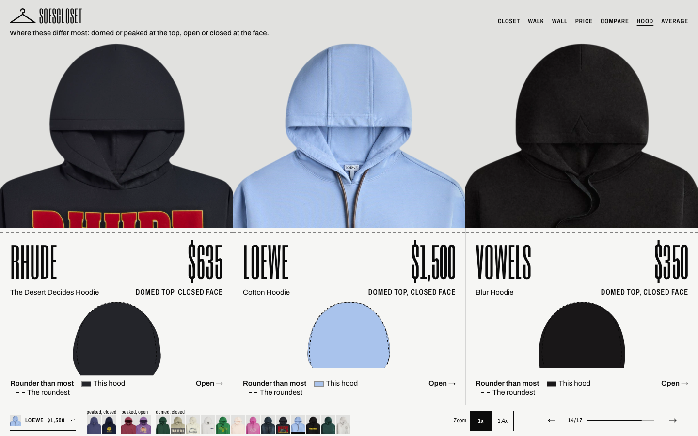
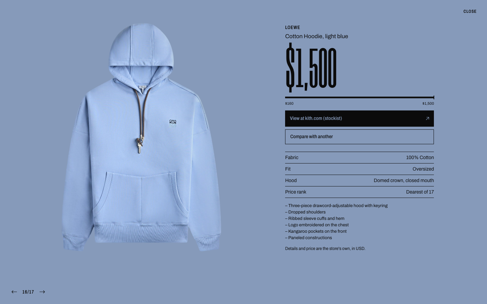

# soescloset

A visual comparison of 17 pullover hoodies.


**Try it live → [soescloset.vercel.app](https://soescloset.vercel.app)**

## Rooms

The site is a set of rooms. Each one shows the same 17 hoodies in a different way.

| Room | What you do |
|---|---|
| Home | Drag across the hoodie to paint its color in |
| Closet | See all 17 at once, sort them, or pick two to compare |
| Walk | Slide a rail of hanging hoodies and read the tags |
| Wall | One slit per hoodie. The higher the dye, the more it costs |
| Price | Every hoodie at the same scale, with height set by price |
| Compare | Split two hoodies down the middle and drag the line |
| Hood | See whose hood is domed or peaked, open or closed |
| Average | All 17 traced on top of each other, plus a few numbers |

Click any hoodie to open its page with the price, fabric, fit and a link to the store.

<table>
<tr>
<td width="50%"></td>
<td width="50%"></td>
</tr>
<tr>
<td></td>
<td></td>
</tr>
<tr>
<td></td>
<td></td>
</tr>
</table>

## How it works

The photos come from 12 different stores, so they never match. `pipeline/` is a set of Node scripts that turns each one into a cutout on the same canvas and measures the garment from the image. That's why the hoodies look like one collection.

The site is plain HTML, CSS and JavaScript, with no framework and no build step. The lines in the background are a small WebGL2 shader, and the suggest box writes to a Google Sheet through Apps Script.

Prices were copied from the brand and store sites, so a few may be out of date.

## Getting started

```bash
python3 -m http.server 8790 --directory site
```

Open [http://localhost:8790](http://localhost:8790).

## Project structure

```
site/
├── index.html      # Page shell and top bar
├── core.js         # Shared state, data and the draw loop
├── rooms.js        # Routes and page turns between rooms
├── mover.js        # Drag, scroll, swipe and keys for each room's rail
├── motion.js       # Easing helpers
├── bg.js           # WebGL2 background
├── data.json       # The 17 hoodies
└── parts/          # One JS and CSS pair per room
pipeline/           # Product photos to cutouts and measurements
tools/              # Screenshot and build scripts, plus the suggest box script
```

Not affiliated with any brand or store. Product images and names belong to their owners.
